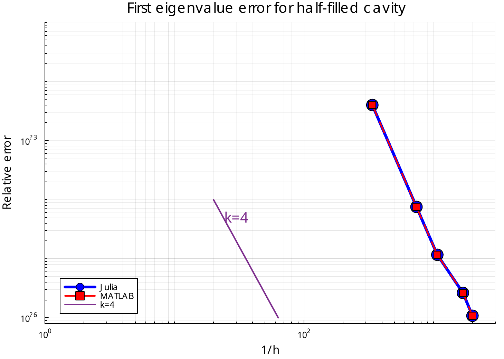

# TFG: Cálculo de Funciones de Base Hexaédricas de Elementos Finitos para Electromagnetismo en Julia

[](https://github.com/ab0nio/TFG-FEM/actions/workflows/ci.yml)
[](LICENSE)

Trabajo de Fin de Grado (Ingeniería Telecomunicación, UC3M) sobre el Método de
Elementos Finitos aplicado a electromagnetismo computacional: implementación en Julia
de funciones de base hexaédricas *curl-conforming* de Nédélec de segundo orden descrito en:

> A. Amor-Martin y L. E. Garcia-Castillo, "Second-Order Nédélec Curl-Conforming
> Hexahedral Element for Computational Electromagnetics," *IEEE Transactions on
> Antennas and Propagation*, vol. 71, no. 1, enero 2023.
> DOI: [10.1109/TAP.2022.3216554](https://doi.org/10.1109/TAP.2022.3216554)

---

## English summary

A from-scratch Julia implementation of the **second-order Nédélec curl-conforming
hexahedral element** for computational electromagnetics, reproducing the element
construction and the numerical results of the IEEE TAP paper above.

The element has **54 degrees of freedom** per hexahedron: 12 edges × 2, 6 faces × 4,
and 6 volume functionals. Building it requires solving four non-trivial problems:

- **Unisolvent basis construction.** 54 hierarchical monomials are generated under the
  Nédélec constraints, then the DOF functional matrix `G` is inverted to obtain the
  coefficient matrix `W = G⁻¹`. The test suite verifies that `G` is unisolvent and that
  `W` reproduces Table II of the paper.
- **Piola transforms.** Basis functions are defined on the reference element and mapped
  to physical elements through the Jacobian, with the covariant Piola transform for the
  field and the contravariant one for its curl.
- **DOF orientation on shared edges.** Two elements sharing an edge must agree on the
  sign of that edge's DOFs. The global numbering resolves this consistently, which is
  what makes the assembled system correct on unstructured meshes.
- **Material interfaces.** The half-filled cavity has a dielectric slab that cuts through
  elements; the permittivity is carried per element by the mesh tags rather than
  reconstructed geometrically.

**Validation.** The implementation is checked against the paper's tables, against a
reference MATLAB implementation (1:1 agreement on local matrices, coefficients, and
eigenvalues), and against an analytic solution for the half-filled cavity. The observed
convergence rate is **4.60** against the paper's **4.55** (Fig. 7).

**Stack:** Julia, sparse assembly (COO → CSC), ARPACK `eigs`, Gmsh for mesh I/O.

---

## Resultados

Convergencia del primer autovalor de la cavidad semillena frente al refinamiento,
comparada con la implementación de referencia:



| n (elementos por eje) | h | error rel. k² |
|---|---|---|
| 1 | 1.0000 | 5.979e-01 |
| 2 | 0.5000 | 8.104e-03 |
| 4 | 0.2500 | 6.360e-04 |
| 8 | 0.1250 | 4.168e-05 |

Pendiente log-log extremo a extremo: **4.60** (paper: 4.55, Fig. 7).

Otros resultados verificados por la suite de tests:

- **Tabla II del paper**: los 54 coeficientes de `W` son enteros y coinciden.
- **Tabla III**: números de condición de las matrices locales.
- **Equivalencia con la referencia**: mismos autovalores medios en las 5 mallas del
  paper (tolerancia relativa 1e-6).
- **Conteo de DOFs globales** sobre mallas no estructuradas: 318, 1678, 4062, 14916,
  23124 para las 5 mallas.

---

## Estructura del repositorio

- **[`NedelecHex/`](NedelecHex/)**: paquete Julia con la implementación. En el orden en que recomiendo leer los módulos para entender el proyecto:

  1. **`Geometry/ReferenceHex.jl`**: define la topología del hexaedro de referencia unidad.
  2. **`Math/GaussQuadrature.jl`**: calcula la integral mediante Gauss para arista, cara y volumen.
  3. **`Geometry/Mesh.jl`**: construye una malla estructurada y orientada a base de hexaedros (se usa sobre todo el `struct` que define, ya que la malla la importamos del paper).
  4. **`Bases/Monomials.jl`**: genera los 54 monomios con las restricciones de Nédélec y también el curl de los monomios.
  5. **`Bases/DOFs.jl`**: implementa los 3 tipos de funcionales para un monomio dado y devuelve un número real.
  6. **`Bases/CoefficientGenerator.jl`**: construye G (monomios evaluados) y la invierte para sacar W (coeficientes), y comprueba que tenga un número de condicionamiento bajo.
  7. **`Math/CoordinateTransforms.jl`**: transforma un punto 2D de una cara y devuelve el 3D correspondiente.
  8. **`Bases/BasisEval.jl`**: evalúa las 54 funciones de base en un punto.
  9. **`Assembly/GlobalDOFs.jl`**: pasa de DOFs locales a DOFs globales (que dos elementos que compartan arista tengan el mismo DOF global en esa arista).
  10. **`Assembly/Assembly.jl`**: toma las funciones de base locales y la tabla de conectividad de los DOFs globales, y produce el sistema global `Kx = λMx`.
  11. **`Benchmark/HalfFilledCavity.jl`**: cavidad rectangular a×b×c con paredes PEC y una losa dieléctrica de permitividad εᵣ que ocupa z ∈ [0, h], con el resto (ε₀) vacío. Se buscan los k para los que existe un campo no trivial que satisface Maxwell, PEC en las paredes y continuidad de las componentes tangenciales, resolviendo la ecuación de resonancia.
  12. **`NedelecHex.jl`**: módulo que agrupa todos los `include`.

- **[`NedelecHex/scripts/`](NedelecHex/scripts/)**: scripts sueltos (exportación de
  mallas a Gmsh, impresión de autovalores y de monomios). No forman parte del paquete.

- **[`visualization/manim/`](visualization/manim/)**: animaciones en
  Python/Manim que ilustran la formulación y los resultados.

- **`docs/`**: figuras usadas en este README.

## Uso (paquete Julia)

```bash
cd NedelecHex
julia --project=.

# Ejecutar todos los tests
julia --project=. test/runtests.jl

# Ejecutar los tests con explicaciones de lo que van comprobando
NEDELEC_TEST_VERBOSE=1 julia --project=. test/runtests.jl

# Omitir tests concretos
NEDELEC_TEST_SKIP="06,09" julia --project=. test/runtests.jl
```

Los tests (`test/runtests.jl`) van en orden construyendo uno encima del otro en orden de complejidad ascendente

| Test | Qué verifica |
|---|---|
| `test_01_quadrature.jl` |Comprobar la integración numérica por Gauss en  1D/2D/3D |
| `test_02_monomials.jl` | Comprobar que los 54 monomios y sus rotacionales están bien generados |
| `test_03_dofs.jl` | Comprobar que las integrales de los funcionales de los DOFs de Arista, Cara y Volumen se calculan correctamente comparando con integrales conocidas |
| `test_04_coefficients.jl` |Comprobar que la matriz G es unisolvente, W con coeficientes enteros y menores a 216  y coinciden con la Tabla II del paper |
| `test_05_reference_element.jl` | Jacobiano, propiedad dual, Kᵉ/Mᵉ, Tabla III (números de condición) |
| `test_06_gmsh_node_order.jl` | Comprobar que una permutación que apliqué debido a un comportamiento inesperado de Gmsh es realmente necesaria|
| `test_07_bases_eval.jl` | Las 54 bases evaluadas en el punto central, comparadas con la Tabla II del paper y con la salida de la implementación de referencia |
| `test_08_assembly.jl` | Ensamblaje global en progresión 1 → 2 → 8 elementos: un elemento (núcleo espurio de dimensión 26), dos elementos adyacentes (DOFs compartidos y orientación de aristas) y malla 2×2×2 (conteo combinatorio y propiedades globales) |
| `test_09_tags.jl` | Etiquetado de la malla: contorno (PolyFace) y material (Solid) |
| `test_10_half_filled_cavity.jl` | Benchmark de la cavidad semillena: convergencia O(h⁴) en autovalores y equivalencia 1:1 con la referencia sobre las mallas del paper |

> **Nota sobre `test_10`**: el bloque de equivalencia usa los CSV de malla y de
> etiquetas (`matlab_nodes_*.csv`, `matlab_elems_*.csv`, `matlab_solids_*.csv`,
> `matlab_elemsolid_*.csv`) de `test/data/meshes/`. Si faltan, el test se marca
> como *broken* en lugar de fallar. Las etiquetas de material se regeneran con
> `scripts/generate_material_tags.jl`, que las deduce de la geometría (losa en
> `x > (x0+x1)/2`, εᵣ=2).

## Verificación

- **Benchmark de la cavidad semillena**: problema de autovalores generalizado
  con solución analítica conocida (ecuación de resonancia trascendente);
  convergencia O(h⁴) observada para el elemento de segundo orden

- **Cruce con la implementación de referencia**: comparación de matrices locales,
  coeficientes y autovalores entre ambas implementaciones.

## Licencia

MIT — ver [`LICENSE`](LICENSE).
